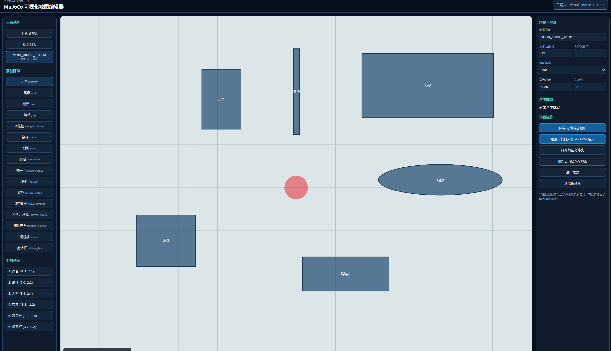
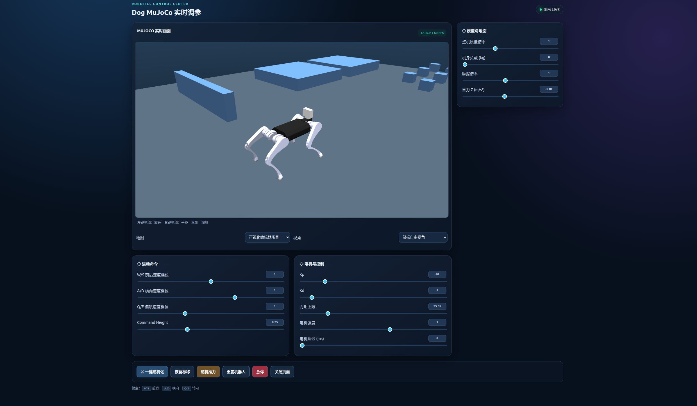
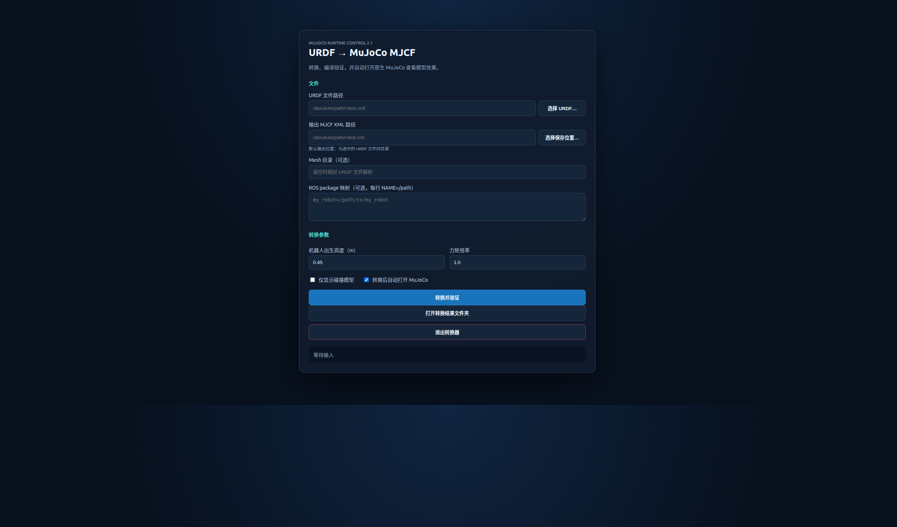

# MuJoCo Runtime Control 2.1

面向机器人 MuJoCo 仿真的浏览器控制、地形编辑和 sim-to-sim 辅助工具。

项目提供可视化地图编辑器、实时仿真面板、参数化障碍、URDF 转 MJCF、地图合并以及可复用的机器人适配接口。默认附带一个可独立运行的 Dog + ONNX 演示，不依赖 HIMLoco 工程。

## 功能

地图右侧可切换“障碍 / 出生点 / 路线”编辑模式。出生点支持点击、拖动以及高度和朝向输入；路线支持添加、拖动、修改高度、排序与删除。路线和出生点保存在 `scene.json`，Dog 预览会读取出生点。路线目前是参考路径，不自动控制机器人。

自定义障碍通过 `register_obstacle(kind, label, builder, defaults, parameters)` 注册。`builder(worldbody, obstacle, index)` 添加 MJCF 元素；参数描述格式为 `[中文名称, 单位, 最小值, 最大值, 步长]`。插件只从用户明确指定的可信 Python 模块加载，不从地图文件执行代码。加载含自定义障碍的地图时，需要启动时再次加载对应插件。

```bash
PYTHONPATH="$PWD/eg${PYTHONPATH:+:$PYTHONPATH}" ./start_editor.sh --obstacle-plugin custom_obstacles
```

示例插件位于 `eg/custom_obstacles.py`，加载后左侧会增加“圆柱台”。

- 插件式障碍注册；路线点添加、拖动、排序、删除；出生位置与朝向编辑（用于 Dog 预览）。


- 在浏览器中创建、保存、载入、修改和删除地形；
- 平地、斜坡、楼梯、噪声地形和 16 种参数化障碍；
- MuJoCo 浏览器画面、鼠标旋转/平移/缩放和多档画质；
- 实时调整速度命令、Kp/Kd、力矩、摩擦、重力、电机延迟和随机推力；
- 实时曲线监控机身高度、线速度、角速度和最大控制量，支持暂停、清空和自定义指标；
- 使用内置 Dog + ONNX 直接验证编辑后的地图；
- URDF 转 MuJoCo MJCF，支持相对 mesh、ROS `package://` 和 DAE 自动转 OBJ；
- 可复用的 `RobotAdapter`、`PositionPDAdapter` 和 `RuntimeScene` 接口。

## 界面预览

### 地图编辑器



### MuJoCo 验证与实时调参



### URDF 转 MJCF



## 环境要求

- Python 3.8+
- Linux 推荐安装 `zenity`，用于图形化选择文件；
- 原生 MuJoCo viewer 需要可用的 OpenGL/桌面环境。

Python 依赖会自动安装：MuJoCo、NumPy、Pillow、ONNX Runtime 和 PyYAML。

## 安装

```bash
git clone https://github.com/uwvwko-zzz/mujoco-gui.git
cd mujoco-gui
python -m pip install -e .
```

Linux 全局键盘监听是可选功能：

```bash
python -m pip install -e ".[keyboard]"
```

也可以安装构建好的 wheel：

```bash
python -m pip install mujoco_runtime_control-2.1.0-py3-none-any.whl
```

## 快速开始

启动地图编辑器：

```bash
./start_editor.sh
```

或使用安装后的命令：

```bash
mujoco-scene-editor --output generated/visual_course
```

默认地址为 <http://127.0.0.1:8765/>。点击“用演示机器人在 MuJoCo 展示”会使用包内 Dog、ONNX 策略和当前地图启动浏览器仿真。

启动 URDF 图形化转换器：

```bash
./start_urdf_converter.sh
```

或：

```bash
mujoco-urdf-converter-gui
```

默认地址为 <http://127.0.0.1:8770/>。

## 命令行工具

```bash
# 地图编辑器
mujoco-scene-editor --output generated/visual_course

# URDF 转 MJCF，并用 MuJoCo 编译验证
mujoco-urdf-to-mjcf robot.urdf robot.xml

# 带 ROS package 和 mesh 目录
mujoco-urdf-to-mjcf robot.urdf robot.xml \
  --mesh-dir ./meshes \
  --package-dir my_robot=/path/to/my_robot

# 查看已有 MJCF
mujoco-mjcf-viewer robot.xml
```

转换器支持 `fixed`、`revolute`、`continuous` 和 `prismatic` 关节。DAE 网格会自动转换到输出目录下的 `mujoco_meshes/*.obj`，生成的 XML 使用相对路径。

## Python 接入

```python
from runtime_control import (
    PositionPDAdapter,
    RuntimeScene,
    bundled_map_specs,
    make_runtime_config,
)
```

使用内置地图：

```python
from runtime_control import bundled_map_specs

maps = bundled_map_specs(("race_track", "stairs", "google_barkour"))
```

生成地形：

```python
from runtime_control import ObstacleSpec, SceneSpec, TerrainSpec, scene_map_spec

scene = SceneSpec(
    name="rough_course",
    terrain=TerrainSpec(kind="noise", seed=42, length=12, width=8),
    obstacles=[
        ObstacleSpec("stairs", x=2.0, params={"count": 6, "rise": 0.12}),
        ObstacleSpec("narrow_bridge", x=5.0, params={"length": 3.0}),
    ],
)
terrain = scene_map_spec(scene, "generated/rough_course")
```

机器人策略中的观测构造、关节顺序、动作缩放和控制频率由机器人项目负责；`runtime_control` 负责场景、界面、地图切换、相机和运行时参数，因此不会反向依赖具体训练框架。

## 项目结构

```text
src/runtime_control/
├── adapter.py              # 通用机器人接口
├── position_pd_adapter.py  # 位置 PD 适配器
├── runtime.py              # 运行时控制
├── session.py              # MuJoCo 场景生命周期
├── scene_builder.py        # 地形与障碍生成
├── scene_editor.py         # 浏览器地图编辑器
├── urdf_converter.py       # URDF/DAE 转换
├── urdf_gui.py             # URDF 图形界面
├── maps/                   # 随 wheel 安装的地图
└── demo/                   # 随 wheel 安装的 Dog 演示
```

## 开发与测试

```bash
python -m pip install -e ".[test,keyboard]"
python -m unittest discover -s tests -v
```

构建 wheel：

```bash
python -m pip wheel . --no-deps -w dist
```

生成文件默认保存在项目自己的 `generated/`，该目录不会提交到 Git。

## 致谢

本项目的早期设计参考了 [ArenaX](https://github.com/Lain-Ego0/ArenaX) 的 MuJoCo 地形编辑与机器人策略验证流程。感谢 ArenaX 项目提供的思路与开源实践，感谢lain。

## 第三方资源

Google Barkour 地图资源的原始 Apache-2.0 许可保存在 `src/runtime_control/maps/BARKOUR_LICENSE.txt`。
